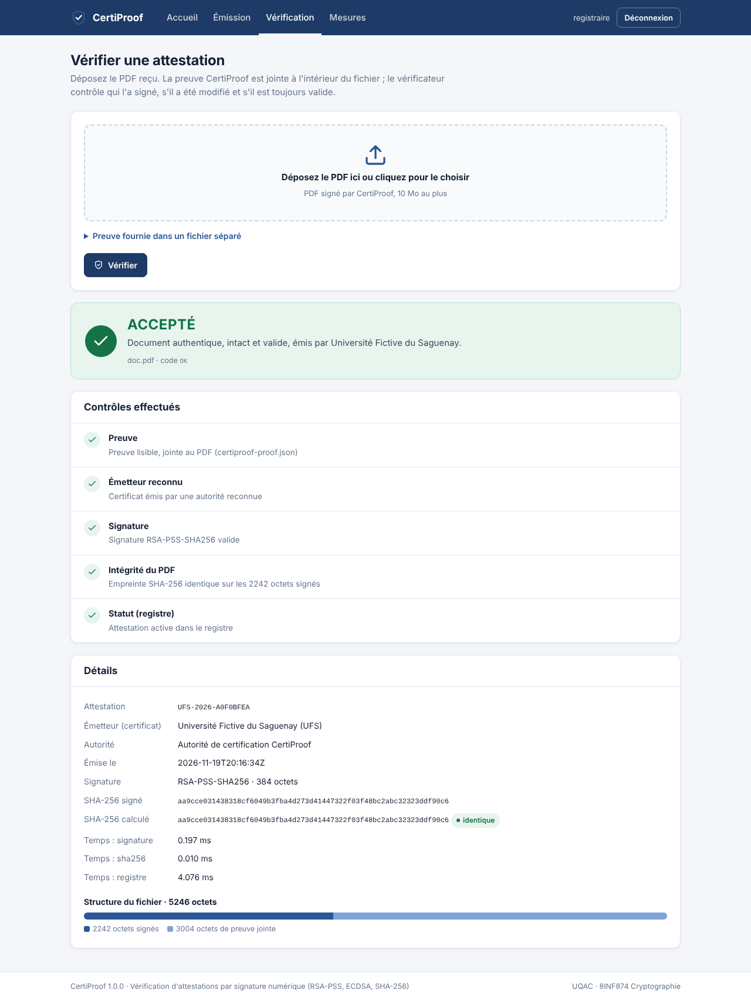
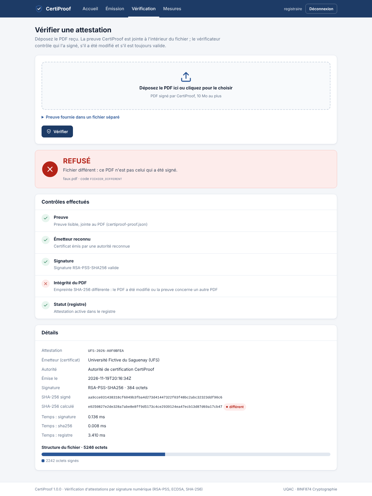
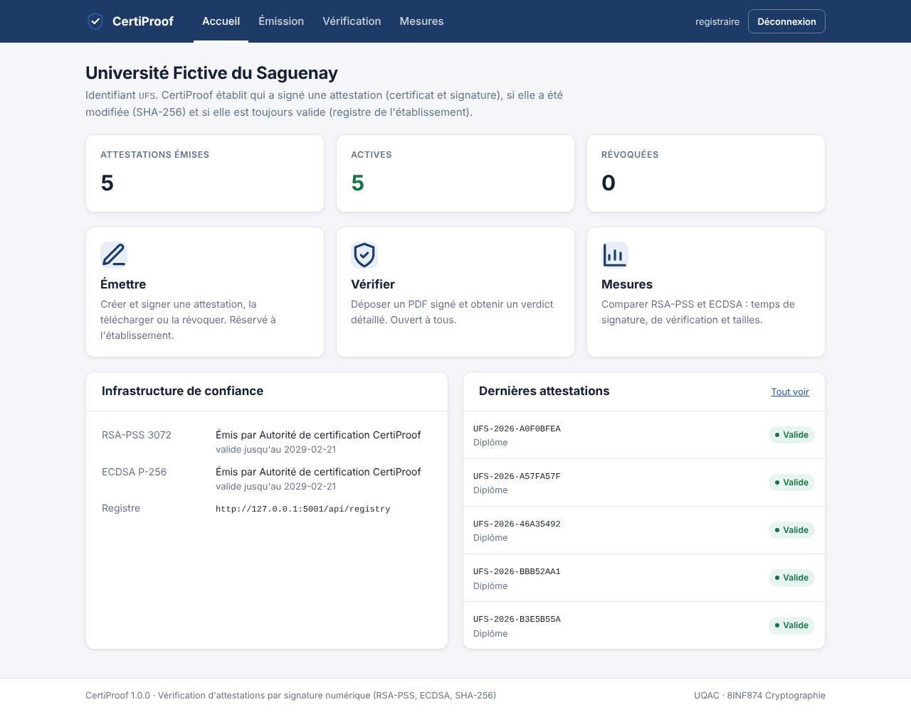

# CertiProof

**Vérification de diplômes et d'attestations par signatures numériques.**

Un établissement signe une attestation une seule fois et remet **un seul fichier PDF**, dans lequel la preuve
(empreinte SHA-256, signature, certificat) est jointe. N'importe qui (recruteur, université) dépose ce PDF dans le
vérificateur et obtient un verdict clair : **ACCEPTÉ**, **REFUSÉ** ou **NON CONFIRMÉ**.

Projet du cours 8INF874 Cryptographie (UQAC, automne 2026). Équipe : Daren HOUEDANOU et Fredy Loïc NGUE TCHANA.

| Vérification d'une attestation authentique | Vérification d'une attestation modifiée |
|---|---|
|  |  |

> Toutes les données sont fictives. L'établissement « Université Fictive du Saguenay » et son autorité de
> certification sont générés localement au premier lancement.

## Sommaire

- [Fonctionnement](#fonctionnement)
- [Installation et lancement](#installation-et-lancement)
- [Utilisation](#utilisation)
- [Évaluation de sécurité](#évaluation-de-sécurité)
- [Ligne de commande, essais et mesures](#ligne-de-commande-essais-et-mesures)
- [Conception](#conception)
- [Architecture du code](#architecture-du-code)
- [Sécurité de l'application](#sécurité-de-lapplication)
- [Limites](#limites)
- [Dépannage](#dépannage)

## Fonctionnement

Le vérificateur répond à trois questions distinctes :

| Question | Contrôle | Notion du cours |
|---|---|---|
| Qui a signé ? | Le certificat de l'émetteur est émis par une AC reconnue à l'avance, et la signature de la preuve est valide | PKI, signatures (séance 10), RSA (6–7), courbes elliptiques (11) |
| Le document a-t-il changé ? | Le SHA-256 du PDF reçu est égal à l'empreinte signée | Hachage SHA (séance 12) |
| Est-il encore valide ? | Le registre de l'établissement renvoie une réponse **signée** et liée à un nonce : `valid`, `revoked` ou `unknown` | Signatures, protection contre le rejeu |

Deux algorithmes de signature sont proposés et comparés à niveau de sécurité équivalent (128 bits) :
**RSA-PSS 3072** et **ECDSA P-256**, tous deux avec SHA-256.

## Installation et lancement

Prérequis : **Python 3.10 ou plus récent**.

- Windows : [python.org](https://www.python.org/downloads/), cocher « Add Python to PATH ».
- Kali, Debian, Ubuntu : `sudo apt install python3 python3-venv`.

```bash
git clone https://github.com/Chris-Lorys/CertiProof.git
cd CertiProof
```

Puis **double-cliquez sur `lancer.bat`** (Windows) ou lancez **`./lancer.sh`** (Linux, macOS). Au premier lancement,
le script crée l'environnement Python (`.venv/`) et installe les dépendances. L'application s'ouvre ensuite dans le
navigateur sur <http://127.0.0.1:5001>.

Installation manuelle équivalente :

```bash
python3 -m venv .venv
source .venv/bin/activate          # Windows : .venv\Scripts\activate
pip install -r requirements.txt
python -m certiproof               # lance l'application et ouvre le navigateur
```

### Premier lancement

Un assistant demande le nom de l'établissement, son identifiant et le mot de passe du compte `registraire`
(8 caractères au moins). Il crée l'autorité de certification, les clés RSA-3072 et ECDSA P-256 de l'établissement,
leurs certificats, le magasin de confiance du vérificateur et le registre SQLite.

Tout est écrit dans `data/` (ou dans le dossier indiqué par `$CERTIPROOF_DATA`), qui est **exclu du dépôt** : clés
privées (droits 0600), base, documents émis, mesures locales.

## Utilisation



| Espace | Accès | Rôle |
|---|---|---|
| Accueil | tous | État de l'installation, certificats, dernières attestations |
| Émission | compte de l'établissement | Émettre une attestation (RSA-PSS ou ECDSA), télécharger le PDF signé, révoquer |
| Vérification | tous | Déposer un PDF signé : verdict, détail des contrôles, empreintes, structure du fichier, temps |
| Mesures | consultation libre, lancement réservé à l'établissement | Comparer RSA-PSS et ECDSA (temps, tailles) et le coût de SHA-256 |

Le vérificateur interroge le registre par HTTP (`/api/registry`), comme s'il était sur une autre machine : il n'a
accès ni à la base ni aux clés.

### Portail de vérification séparé

En production, l'établissement (émission + registre) et le portail public de vérification sont deux serveurs
distincts. On peut les lancer séparément :

```bash
python -m certiproof                               # établissement, port 5001
python -m certiproof serve --role verification    # portail de vérification seul, port 5002
```

Le portail n'a ni clé privée ni base de données : il n'utilise que le magasin de confiance (certificat de l'AC) et
interroge le registre de l'établissement par HTTP. Si on arrête le serveur de l'établissement (Ctrl+C), le portail
répond **NON CONFIRMÉ** : c'est le scénario « registre indisponible », sans aucune simulation.

### API

```bash
curl -F pdf=@diplome.pdf http://127.0.0.1:5001/api/verify          # verdict complet en JSON
curl "http://127.0.0.1:5001/api/registry/UFS-2026-XXXX?nonce=abc"   # réponse de statut signée
```

## Évaluation de sécurité

Les attaques se font avec un outil **extérieur à l'application**, comme le ferait un fraudeur.
`outils/falsifier.py` modifie un PDF signé sans clé ni accès au registre :

```bash
python -m outils.falsifier textes diplome.pdf                                            # textes affichés
python -m outils.falsifier texte diplome.pdf "Passable" "Excellent" -o faux1.pdf         # → FICHIER_DIFFERENT
python -m outils.falsifier rapide diplome.pdf "Passable" "Excellent" -o faux2.pdf        # → CONTENU_AJOUTE_APRES_SIGNATURE
python -m outils.falsifier texte-preuve diplome.pdf "Passable" "Excellent" -o faux3.pdf  # → SIGNATURE_INCORRECTE
python -m outils.falsifier bit diplome.pdf -o faux4.pdf                                  # → FICHIER_DIFFERENT
python -m outils.falsifier sans-preuve diplome.pdf -o faux5.pdf                          # → PREUVE_ABSENTE
cp diplome.pdf faux6.pdf && LC_ALL=C sed -i 's/"issued_at": "2026/"issued_at": "2020/' faux6.pdf  # → SIGNATURE_INCORRECTE
```

Déroulé proposé : émettre une attestation (Émission) → la vérifier (ACCEPTÉ) → déposer chaque faux dans
Vérification (REFUSÉ) → révoquer l'attestation (REFUSÉ) → arrêter le serveur de l'établissement et vérifier sur le
portail séparé (NON CONFIRMÉ).

### Résultats attendus

| # | Situation | Verdict |
|---|---|---|
| S1 | PDF signé original (RSA-PSS et ECDSA), ou PDF d'origine + preuve séparée | ACCEPTÉ |
| S2 | Nom, note ou date modifiés, ou un seul bit de la partie signée | REFUSÉ, fichier différent |
| S2e | Contenu remplacé par une mise à jour ajoutée après la signature | REFUSÉ, contenu ajouté après signature |
| S3 | Signature altérée, preuve d'un autre document jointe, empreinte remplacée dans la preuve | REFUSÉ, signature incorrecte ou fichier différent |
| S4 | Faux établissement (même nom et identifiant, AC non reconnue) | REFUSÉ, émetteur inconnu |
| S5 | Attestation annulée | REFUSÉ, document révoqué (signature correcte) |
| S6 | Registre inaccessible, puis de retour | NON CONFIRMÉ, puis ACCEPTÉ |
| S7 | PDF sans preuve CertiProof | REFUSÉ, preuve absente |
| S8 | Réponse du registre forgée ou rejouée | NON CONFIRMÉ, réponse non authentique |

## Ligne de commande, essais et mesures

Toutes les fonctions restent disponibles sans interface :

```bash
python -m certiproof init --password "..."        # installation sans l'assistant (--openssl : PKI via la CLI OpenSSL)
python -m certiproof issue --type diplome --holder "Alice Tremblay" \
    --program "Baccalauréat en informatique" --grade "Excellent" --date 2026-06-15 --alg rsa
python -m certiproof verify data/issued/UFS-2026-XXXX.pdf
python -m certiproof revoke UFS-2026-XXXX --reason "Erreur de saisie"
python -m certiproof serve --port 8080 --no-browser
```

Jeu d'essai, mesures et tests (pour le rapport) :

```bash
python -m certiproof scenarios            # results/scenarios.md + results/fichiers/ (jeu d'essai complet)
python -m certiproof bench                # results/bench.md, bench.csv, bench.json
python -m certiproof bench --all-levels   # ajoute le niveau 192 bits (RSA-7680 / P-384, plus lent)
python -m pytest                          # tests automatisés
```

`scenarios` crée une PKI jetable dans `data/scenarios/` à chaque exécution (avec une fausse AC pour le scénario S4),
sans toucher à l'installation réelle. Les résultats présents dans `results/` sont les **résultats de référence**,
produits sur une machine Linux x86_64. Les mesures lancées depuis l'interface sont enregistrées dans `data/mesures/`
et ne modifient pas `results/`.

## Conception

### Un seul fichier : la preuve jointe au PDF

```
[ PDF d'origine : pdf_size octets couverts par l'empreinte signée ][ mise à jour incrémentale : pièce jointe certiproof-proof.json ]
```

1. L'établissement génère le PDF, calcule le SHA-256 de ses octets et signe l'enregistrement (qui contient
   l'empreinte et `pdf_size`).
2. Il ajoute la preuve à la fin du fichier par une **mise à jour incrémentale** PDF : une pièce jointe
   `certiproof-proof.json`, visible dans le panneau « Pièces jointes » des lecteurs PDF. Les octets d'origine ne
   changent pas, donc l'empreinte reste valable.
3. Le vérificateur extrait la pièce jointe, recalcule le SHA-256 des `pdf_size` premiers octets, puis reconstruit
   la mise à jour attendue et exige que le fichier reçu soit **exactement** « octets signés + cette mise à jour ».

Le point 3 est essentiel. Le format PDF permet d'ajouter des mises à jour qui remplacent le contenu affiché sans
toucher aux octets d'origine (scénario S2e). Sans ce contrôle, un faux afficherait une autre mention avec une
empreinte valide. Les signatures PDF officielles (PAdES, `ByteRange`) reposent sur le même principe. Un fichier de
preuve séparé reste accepté pour compatibilité (S1c).

### Format de la preuve

```json
{
  "format": "certiproof-proof/2",
  "record": {
    "doc_id": "UFS-2026-3F9A1C7B",
    "issuer_id": "UFS",
    "hash_alg": "SHA-256",
    "pdf_sha256": "4a5587…7270",
    "pdf_size": 2175,
    "issued_at": "2026-11-05T04:30:00Z",
    "registry_url": "http://127.0.0.1:5001/api/registry"
  },
  "signature": { "alg": "ECDSA-SHA256", "value": "<base64>" },
  "certificate": "-----BEGIN CERTIFICATE----- …"
}
```

Octets signés : `"CertiProof/record/v1\0" || JSON canonique(record)` (clés triées, sans espaces, UTF-8).
Les réponses du registre sont signées avec le préfixe `"CertiProof/status/v1\0"`, ce qui empêche de réutiliser une
signature d'un contexte dans l'autre.

Paramètres : RSA-PSS 3072 bits, MGF1-SHA-256, sel de 32 octets ; ECDSA P-256 / SHA-256 (environ 128 bits de sécurité
pour les deux, NIST SP 800-57). Le vérificateur refuse un algorithme qui ne correspond pas à la clé du certificat,
ainsi que les clés RSA de moins de 3072 bits et les courbes autres que P-256, P-384 et P-521.

## Architecture du code

```
certiproof/
  signing.py      RSA-PSS / ECDSA (bibliothèque cryptography, adossée à OpenSSL)
  pki.py          AC, certificats d'établissement, magasin de confiance, validation des certificats
  proof.py        format de la preuve, JSON canonique, SHA-256
  embedding.py    preuve jointe au PDF (mise à jour incrémentale), extraction
  pdfgen.py       génération des attestations PDF (reportlab, sortie reproductible)
  registry.py     registre SQLite : statuts et comptes (mots de passe hachés)
  issuer.py       service d'émission, révocation, réponses de statut signées
  verifier.py     vérification complète et verdict
  web.py          application Flask (rôle « complet » ou « verification »)
  templates/      pages HTML (Jinja2)
  static/         feuille de style, logo, script d'interface
  scenarios.py    jeu d'essai et rapport attendu / observé
  bench.py        mesures RSA-PSS / ECDSA et SHA-256
  cli.py          ligne de commande
outils/falsifier.py      outil d'attaque pour l'évaluation de sécurité (hors application)
scripts/pki_openssl.sh   création de la PKI avec la CLI OpenSSL
lancer.bat / lancer.sh   lancement en un clic (installe les dépendances au premier lancement)
tests/                   tests pytest
results/                 résultats de référence des essais et des mesures
docs/captures/           captures d'écran
```

## Sécurité de l'application

- **Séparation des droits** : seul le compte de l'établissement peut émettre, révoquer et lancer les mesures.
  L'espace Vérification n'utilise que le magasin de confiance et l'API publique, en lecture seule, du registre.
- Le vérificateur n'interroge le registre qu'**après** avoir validé le certificat et la signature, pour ne jamais
  contacter une adresse fournie par un tiers non reconnu.
- Mots de passe hachés (Werkzeug, PBKDF2), cookie de session `HttpOnly` et `SameSite=Lax`, jeton CSRF sur chaque
  formulaire, blocage temporaire après 5 échecs de connexion.
- En-têtes HTTP : `Content-Security-Policy` (aucun script externe ni en ligne), `X-Frame-Options: DENY`,
  `X-Content-Type-Options: nosniff`, `Referrer-Policy`.
- Fichiers déposés limités à 10 Mo ; pages d'erreur sans détail technique (le détail reste dans le terminal).

## Limites

- CertiProof ne garantit ni la véracité des informations saisies par l'établissement ni l'identité de la personne qui
  présente le document.
- Toute modification des octets du PDF, même bénigne (réenregistrement, métadonnées), invalide l'empreinte.
- La sécurité dépend de la protection de la clé privée de l'émetteur. Ici, elle est stockée en clair dans `data/`
  avec des droits restreints ; en production, on utiliserait un HSM ou au moins une clé chiffrée.
- La révocation d'une **attestation** est implémentée. La révocation d'un **certificat** (CRL/OCSP), la gestion d'une
  clé compromise, le renouvellement des certificats et la conservation des preuves sur plusieurs années (horodatage
  de confiance) sont traités dans le rapport.
- Le registre est servi en HTTP local par le serveur de développement de Flask. Ses réponses étant signées et liées à
  un nonce, un intermédiaire ne peut pas les falsifier ni les rejouer, mais il peut les bloquer, ce qui donne le
  verdict NON CONFIRMÉ. Un déploiement réel passerait par HTTPS et un serveur WSGI (gunicorn, waitress).

## Dépannage

| Problème | Solution |
|---|---|
| `lancer.sh` : « Impossible de créer l'environnement Python » | `sudo apt install python3-venv`, puis relancer |
| `Address already in use` | Une autre instance tourne déjà : la fermer, ou `python -m certiproof serve --port 5003` |
| Conflit `git pull` sur `results/` | `git checkout -- results/` puis `git pull` (fichiers régénérés par `scenarios` et `bench`) |
| Repartir d'une installation vide | Arrêter l'application, supprimer le dossier `data/`, relancer |
